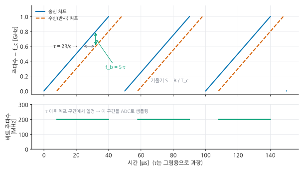

# 글 작성 규칙

이 저장소의 모든 글 초안이 따르는 규칙이다. 글을 쓰는 사람(사람이든 에이전트든)은 쓰기 전에 이 파일과 목차(비공개 저장소 `hsjang545/notes-drafts`의 `curriculum.md`)를 읽는다.

## 독자와 목소리

- 독자: 자율주행·ADAS·로봇에서 센서 데이터를 다루는 엔지니어, 대학원생. 학부 공학 기초(선형대수, 신호, 네트워크 기본)는 안다고 가정한다.
- 목소리: 실무 엔지니어가 동료에게 설명하는 평서문(~다). 과장, 감탄, 광고 문구를 쓰지 않는다.
- 개념만 나열하지 않는다. "왜 이게 문제가 되는가 → 원리 → 실제로 하는 법 → 확인하는 법 → 흔한 함정" 흐름을 기본으로 한다.
- 필자의 경험담을 지어내지 않는다. 경험이 들어가면 좋을 자리에는 HTML 주석으로 표시만 한다.
  `<!-- 경험: 실차에서 PTP 오프셋이 튀었던 사례와 원인 -->`

## 정확성

- 숫자(정밀도, 대역폭, 표준 값)는 표준 문서나 널리 알려진 값만 쓴다. 확실하지 않으면 범위로 쓰고 "일반적으로", "제품마다 다르다"를 붙인다.
- 실험 결과처럼 보이는 수치를 지어내지 않는다. 예시 출력은 "예시 출력"이라고 밝힌다.
- 표준·규격은 이름과 번호를 정확히 쓴다(IEEE 1588-2019, IEEE 802.1AS, ISO 11898-1, ISO 8855, REP-103 등).
- 확인이 필요한 내용은 `<!-- 확인 필요: ... -->`로 남긴다.

## 공개 금지 (반드시 지킴)

- 필자 소속 과제의 고객사·발주처 이름, 차량 내부 신호명, 실제 장비 모델명과 장착 위치, 실제 IP 주소, 비공개 사진.
- 시장에 공개된 제품을 유형 설명의 예로 드는 것은 괜찮다. 단 "필자가 이 제품을 썼다"는 식으로 쓰지 않는다.
- 예시 IP는 문서용 대역(192.0.2.0/24, 198.51.100.0/24)이나 일반적인 사설 대역 예시만 쓴다.

## 코드

- 환경: Ubuntu 22.04/24.04, ROS 2 Humble/Jazzy, Python 3.10+. 버전에 따라 다르면 밝힌다.
- 명령은 그대로 복사해 실행할 수 있게 쓴다. 코드 블록에 언어를 지정한다(`bash`, `python`, `ini`, `yaml`, `text`).
- 파이썬 코드는 타입 힌트를 쓰고, 예외를 삼키지 않는다. 표준 라이브러리와 numpy, pandas, matplotlib, rosbags, python-can, cantools, opencv-python 정도만 쓴다.
- 코드가 길면 핵심만 본문에 넣고, 전체 흐름을 설명한다.

## 형식 (Jekyll Chirpy)

- 파일: 초안은 비공개 저장소 `hsjang545/notes-drafts`의 `_drafts/<접두사>-<두 자리 번호>-<영문-슬러그>.md`(예: `sync-04-linuxptp-ubuntu.md`)에 쓰고, 게시할 때 이 저장소의 `_posts/YYYY-MM-DD-<같은 슬러그>.md`로 옮긴다.
- 앞부분(front matter):

```yaml
---
title: "PTP를 우분투에서 구성하기: linuxptp로 ptp4l·phc2sys 설정"
description: "검색 결과에 보일 한두 문장 요약 (120자 안팎)"
date: 2026-11-10 09:00:00 +0900
categories: [시간 동기화, PTP]
tags: [ptp, linuxptp, ptp4l, phc2sys, ubuntu]
series: sync
series_order: 4
math: true      # 수식이 있을 때만
mermaid: true   # 도식이 있을 때만
---
```

- `categories` 첫 값은 파트 이름(센서, 통신, 시간 동기화, 센서 캘리브레이션, 데이터 취득)이고 두 번째 값은 세부 주제다.
- 제목은 검색어가 앞에 오게 쓴다. 예: "레이더 단독 캘리브레이션: 장착 각도 오차를 찾는 세 가지 방법".
- 첫 문단 2~4문장: 이 글이 푸는 문제와 다 읽으면 할 수 있게 되는 것.
- 본문 제목은 `##`부터 쓴다(`#`는 쓰지 않는다).
- 수식: 블록은 `$$ ... $$`를 앞뒤 빈 줄과 함께, 인라인도 `$$ ... $$`를 쓴다(kramdown 규칙).
- 도식: ```` ```mermaid ```` 코드 블록.
- 표를 적극적으로 쓴다(비교, 사양, 명령 요약).
- 강조 상자: `> 내용` 다음 줄에 `{: .prompt-tip }` / `.prompt-info` / `.prompt-warning` / `.prompt-danger`.
- 다른 글 링크: `[글 제목]()`는 게시 후에만 동작하므로, 초안에서는 `[[sync-04]]`처럼 글 번호로 적어 둔다. 게시할 때 바꾼다.
- 마지막 섹션: `## 정리` (핵심 3~5줄), 필요하면 `## 참고 자료` (표준, 공식 문서, 대표 논문).

## 분량

- 본문 4,000~9,000자(한글 기준)를 기본으로 하고, 구현과 점검을 다루는 글은 더 길어도 된다. 개념만 있는 짧은 글은 쓰지 않는다.

## 그림

- 구조·흐름·순서는 mermaid 코드 블록으로 그린다(`mermaid: true`).
- 수치·기하·파형·그래프는 matplotlib 스크립트로 SVG를 만든다.
  - 스크립트: `tools/figures/<글 파일명>.py` (예: `tools/figures/sync-00-why.py`). 맨 위에 `sys.path.insert(0, os.path.dirname(os.path.abspath(__file__)))` 후 `from _style import setup, save, COLORS, GRAY`.
  - 출력: `save(fig, "<글 파일명>", "<그림 이름>")` → `assets/img/<글 파일명>/<그림 이름>.svg`. 폴더 이름을 `_`로 시작하지 않는다(Jekyll이 무시함).
  - 실행: 스크립트를 커밋하면 GitHub Actions(`그림 생성`)가 SVG를 다시 만들어 커밋한다. 수동 실행은 Actions 탭 → `그림 생성` → Run workflow.
  - 글자는 한국어, 흰 배경, 파일 하나 300 KB 이하. 남의 그림을 베끼지 않고 직접 그린다.
- 본문 삽입:

```markdown
{: width="720" }
_그림 1. 송신 처프와 수신 처프의 주파수 차이가 비트 주파수가 된다._
```
